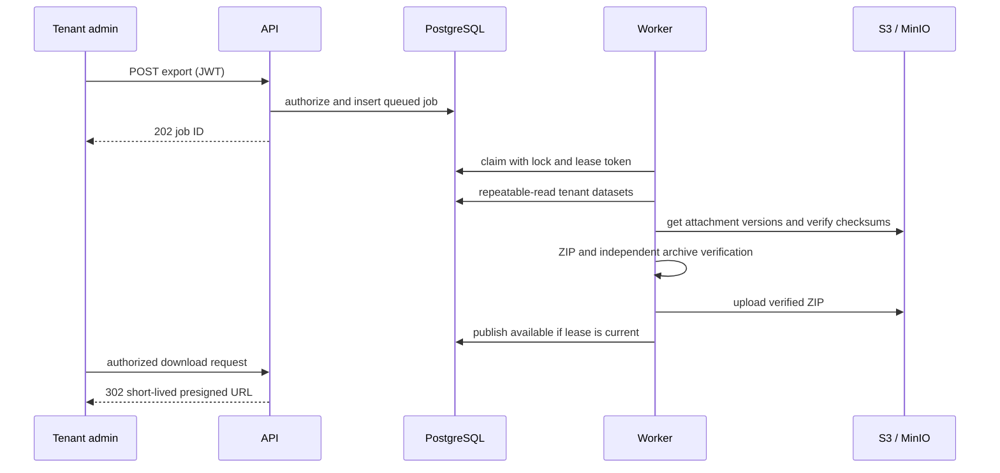

# Architecture

The API authenticates a signed JWT, looks up its active user and tenant in PostgreSQL, checks the administrator role, then inserts an idempotent job. PostgreSQL is the durable queue. The worker claims jobs with `FOR UPDATE SKIP LOCKED`, assigns a per-attempt lease token, and renews that lease while collecting data.

Collection runs in a read-only repeatable-read transaction. Each registered dataset uses a typed, tenant-filtered query with stable ID ordering. Composite foreign keys protect user, project, membership, invoice, and invoice item relationships. Attachment owners are checked against the same tenant snapshot and by a database trigger. Attachment bytes are read from S3 using a tenant-prefixed object key and optional object version, then matched against stored size and SHA-256 metadata.

The worker writes JSONL datasets, attachment binaries, and a manifest into a ZIP, verifies archive paths, record counts and checksums, then uploads the artifact to the private export bucket. It changes the job to available only if its attempt lease still owns the running job. The API checks tenant and role again before serving the manifest or returning a 60-second S3 presigned URL. The worker removes expired artifacts and marks the jobs expired.

The current staging implementation is memory-backed and capped; it is not intended for large production exports. PostgreSQL row-level security is not enabled. Tenant-scoped predicates and composite constraints remain the application and schema controls.
